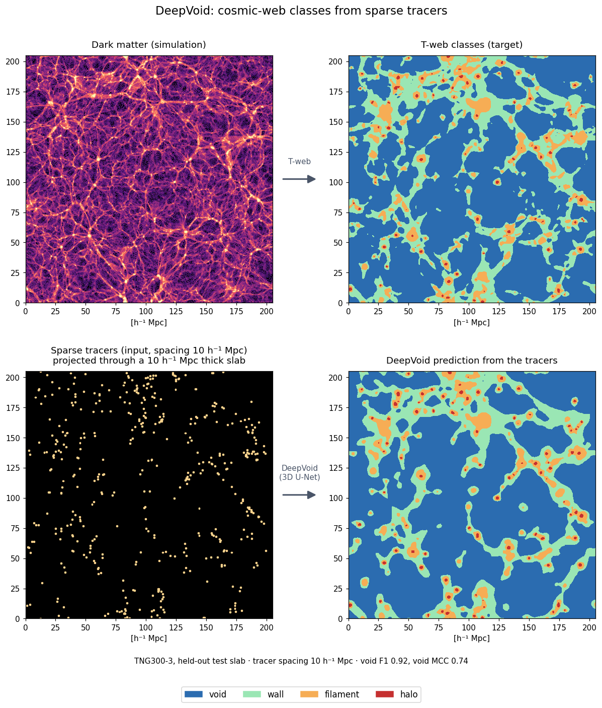

# DeepVoid

DeepVoid labels every cell of a simulated universe as void, wall, filament or
halo with a 3D U-Net. The labels it learns are the tidal-tensor (T-web)
classification of the full matter field. The point is to recover them from
much sparser tracers, such as halos or galaxies, where the matter field is
not available.



This repository is a rewrite of the research code behind the DeepVoid paper
([Kumagai et al. 2026, ApJ 998, 85](https://doi.org/10.3847/1538-4357/ae2c80)) and dissertation,
made to be used on other simulations. [docs/overview.md](docs/overview.md)
explains the whole problem from the physics up.

## Status

- **Ready:** training on your own simulation, scoring, figures.
- **Not yet published:** trained weights. They will follow the final training
  run.
- **Tested on:** IllustrisTNG TNG300-3-Dark at redshift 0, in real space,
  with subhalos as tracers.
- **Not tested on:** other simulations or cosmologies, redshift space, survey
  masks and selection, or real galaxy surveys. A model trained here should
  not be assumed to carry over to those without checking.
- **Not included:** a void catalog. The output is a class for each cell;
  turning void cells into a list of voids with centers and sizes is future
  work.

## Results so far

One model, trained on TNG300-3 subhalos at four mean separations at once, on
a 512³ grid. Scores are on a slab of the box that was never used for
training, for choosing the model or for tuning anything.

| Mean tracer separation (h⁻¹ Mpc) | 3 | 5 | 7 | 10 |
|---|---|---|---|---|
| Void against everything else, MCC | 0.918 | 0.880 | 0.825 | 0.736 |
| All four classes, MCC | 0.885 | 0.842 | 0.781 | 0.683 |

MCC is the Matthews correlation coefficient: 1 is perfect, 0 is chance. The
config is `configs/research/subhalo/C_mixed_smooth2ch_depth5.yaml`. At a
separation of 10, about 27% of wall cells are still labelled void; that is
the main remaining error.

## Install

```bash
pip install "deepvoid[tf,figures] @ git+https://github.com/skumagai3/deepvoid.git"
```

Python 3.10 or later and TensorFlow 2.16 or later. Building grids and labels
needs only NumPy and SciPy; training is meant for a GPU.

## Train on your own simulation

You need the matter density on a grid (for the labels) and the tracers the
model should work from.

```python
from deepvoid import Project
from deepvoid.train import run

project = Project("my_simulation")                      # a folder: data/, catalog.yaml, runs/

project.add_density("dm", matter_density, box_size=205.0, tracer="dm")
project.add_labels("labels", density="dm")              # T-web classes from the matter density
project.add_tracers("halos/L5", positions, box_size=205.0, n=512,
                    masses=masses, spacing=5.0)         # most massive halos, 5 h^-1 Mpc apart on average
print(project.summary())

cfg = project.config("first_run", inputs=["halos/L5"], labels="labels")
out = run(cfg)                                          # trains, then scores the held-out slab
```

Then look at the result:

```python
from deepvoid.runs import Run

r = Run(out)
r.scores()                    # test-slab scores
scores = r.predict()          # class scores for every cell, shape (n, n, n, 4)
```

Two notebooks walk through this on Google Colab:

- [`notebooks/01_quickstart.ipynb`](notebooks/01_quickstart.ipynb) runs every
  step on a small sample that ships with the repository.
- [`notebooks/02_your_simulation.ipynb`](notebooks/02_your_simulation.ipynb)
  is a template for your own data.

Grids are arrays of shape (n, n, n) with axis order (x, y, z), covering a
periodic box, with lengths in h⁻¹ Mpc. The default labels need cells smaller
than 1 h⁻¹ Mpc.

## The data behind the results

The TNG300-3-Dark and Bolshoi grids used here (dark matter, T-web labels,
and subhalos or halos at mean separations of 3, 5, 7 and 10 h⁻¹ Mpc) are on
Zenodo: [doi:10.5281/zenodo.24233069](https://doi.org/10.5281/zenodo.24233069).
They are derived from IllustrisTNG and Bolshoi data, so please credit those
simulations as the record describes.

```python
from deepvoid import data

catalog = data.fetch(["tng300-3/mask", "tng300-3/subhalos/L10"], "deepvoid_data")
labels = catalog.load("tng300-3/mask")
```

`fetch` checks every file against the record's checksums and writes a
`catalog.yaml` in the folder. To run a config from `configs/research/` on
these files, set `catalog: deepvoid_data/catalog.yaml` in it.

## The choices, and where they are explained

Every setting of a run is in one config.
[`configs/template.yaml`](configs/template.yaml) lists all of them with a
comment on each. The ones that matter most:

| Choice | Default | What it means |
|---|---|---|
| Labels | T-web, smoothing 1 h⁻¹ Mpc, eigenvalue threshold 0.65 | What counts as a void. Set in `Project.add_labels`; [docs/conventions.md](docs/conventions.md) |
| Split | 70 / 15 / 15% slabs with buffers | Which part of the box trains the model, which picks the best epoch, and which is scored once at the end |
| Input scaling | log₁₀(ρ/ρ̄ + 10⁻³), standardized on the training slab | How density becomes the network input |
| Smoothed channel | off | A second input channel with the tracer field smoothed, for sparse tracers |
| Network depth | 4 levels | How far apart two tracers can be and still be related |
| Several spacings in one model | one input | List several inputs and each training crop is drawn from one of them |
| Weight averaging (EMA) | on | Validation, testing and the saved model use a running average of the weights |
| Model choice | best validation void MCC | Which epoch is saved |

[docs/training.md](docs/training.md) covers logs, resuming, seeds, fine-tuning
from another model and the less common options.

## Layout

```
configs/template.yaml   every setting, explained
configs/research/       the experiments behind the results
notebooks/              quickstart and your-simulation notebooks; research/ has the rest
sample/                 a small TNG300-3 sample for the quickstart
docs/                   overview, conventions, training
src/deepvoid/
  project.py            Project: your grids, their catalog and your runs
  volume.py, io.py      a periodic grid with its metadata; reading and writing
  catalog.py            datasets by name
  data.py               downloading the published grids
  grid.py               cloud-in-cell gridding of point tracers
  labels/               T-web classification
  observe/              tracer selection, redshift space
  sources/              simulation readers
  split.py              train / validation / test slabs
  preprocess.py, inputs.py   input scaling and channels
  pipeline.py           random training crops
  models/, losses.py    the 3D U-Net and its losses
  config.py, train.py   settings and the training loop
  runs.py               Run: a finished run's config, log, scores, model and predictions
  predict.py, evaluate.py, calibrate.py   full-box prediction and scoring
  figures.py, interpret.py   figures; looking inside a model
tests/                  tests of everything that does not need TensorFlow
```

## How this differs from the first DeepVoid paper

The code released with the first paper is in
[deepvoid_misc](https://github.com/skumagai3/deepvoid_misc). This package is
a rewrite with the same scientific target (T-web classes, eigenvalue
threshold 0.65, effective smoothing 1 h^-1 Mpc) but a different data
pipeline and evaluation, so scores from the two are not directly
comparable.

| | First paper (`deepvoid_misc`) | This package |
|---|---|---|
| Training data | 128³ subcubes cut from the box in advance, stored with rotated copies | No pre-cut subcubes: random 96³ crops drawn from the training region on every step |
| Train / validation / test | Subcubes divided into training and validation sets | The box is divided first into training, validation and test slabs (70/15/15%) separated by buffer slabs; crops never leave their slab |
| Final scores | Validation subcubes | A separate test slab that is never used for choosing models, early stopping or thresholds |
| Augmentation | Rotated copies stored with the data | The 48 rotations and reflections of a cube, applied on the fly to each training batch |
| Normalization | Min–max, refit on each volume | log10(ρ/ρ̄ + 10⁻³), standardized with statistics from the training slab and saved with the model |
| Sparse tracers | Curriculum from dense to sparse inputs, freezing encoder blocks | One model trained on several tracer spacings at once, optionally with a smoothed copy of the input as a second channel; curricula and spacing conditioning (FiLM, feature-wise linear modulation) remain options |
| Full-box prediction | Overlapping patches, keeping their central regions | The same, with the kept region and overlap set in the config |
| Scores | Per-class F1, MCC | The same, plus void-vs-rest scores, a void-score threshold chosen on the validation slab, and calibration of the class scores |

## Citing

If you use DeepVoid in your research, please cite:

```bibtex
@ARTICLE{2026ApJ...998...85K,
       author = {{Kumagai}, Sam and {Vogeley}, Michael S. and {Aragon-Calvo}, Miguel A. and {Douglass}, Kelly A. and {BenZvi}, Segev and {Neyrinck}, Mark},
        title = "{DeepVoid: A Deep Learning Void Detector}",
      journal = {\apj},
     keywords = {Voids, Cosmic web, Large-scale structure of the universe, Cosmology, Convolutional neural networks, Instrumentation and Methods for Astrophysics},
         year = 2026,
        month = feb,
       volume = {998},
       number = {1},
          eid = {85},
        pages = {85},
          doi = {10.3847/1538-4357/ae2c80},
archivePrefix = {arXiv},
       eprint = {2504.21134},
 primaryClass = {astro-ph.IM},
       adsurl = {https://ui.adsabs.harvard.edu/abs/2026ApJ...998...85K},
      adsnote = {Provided by the SAO/NASA Astrophysics Data System}
}
```

and the simulation your data come from.

## Data and credits

The IllustrisTNG simulations are provided by the IllustrisTNG collaboration
(https://www.tng-project.org). Please cite:

- Springel et al. 2018, MNRAS 475, 676
- Pillepich et al. 2018, MNRAS 475, 648
- Nelson et al. 2018, MNRAS 475, 624
- Naiman et al. 2018, MNRAS 477, 1206
- Marinacci et al. 2018, MNRAS 480, 5113
- Nelson et al. 2019, Computational Astrophysics and Cosmology 6, 2 (data release), doi:10.1186/s40668-019-0028-x

The Bolshoi simulation is distributed through CosmoSim
(https://www.cosmosim.org). Please cite:

- Klypin, Trujillo-Gomez & Primack 2011, ApJ 740, 102
- CosmoSim Bolshoi dataset, doi:10.17876/cosmosim/bolshoi

## License

MIT. See [LICENSE](LICENSE).
