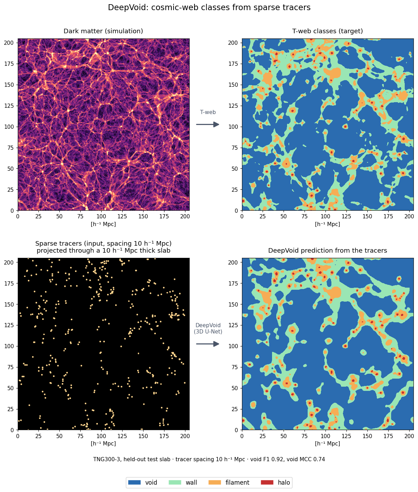
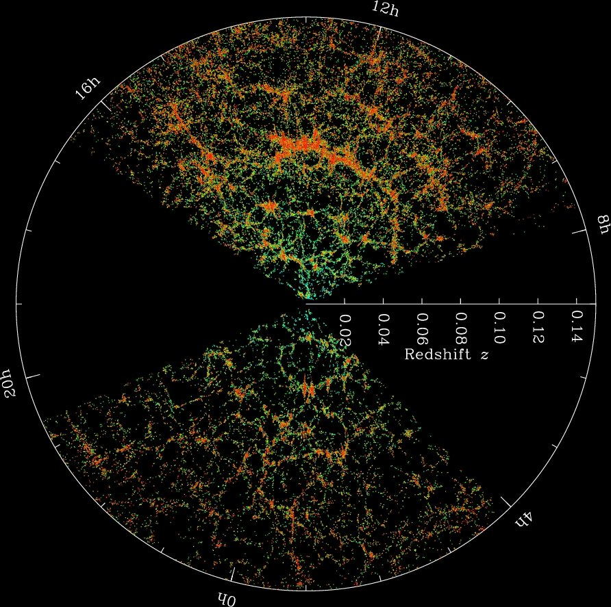
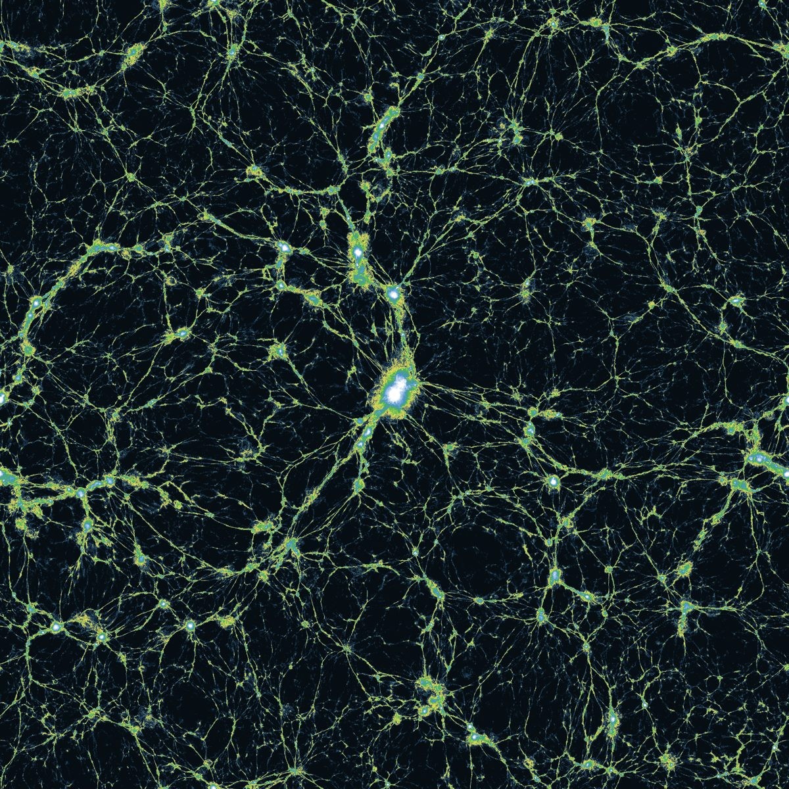
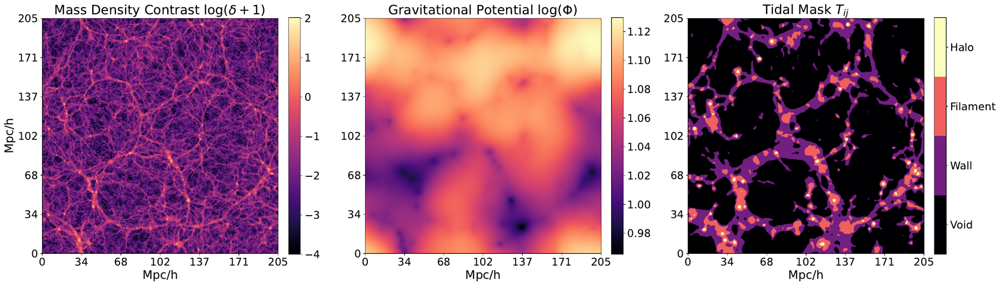
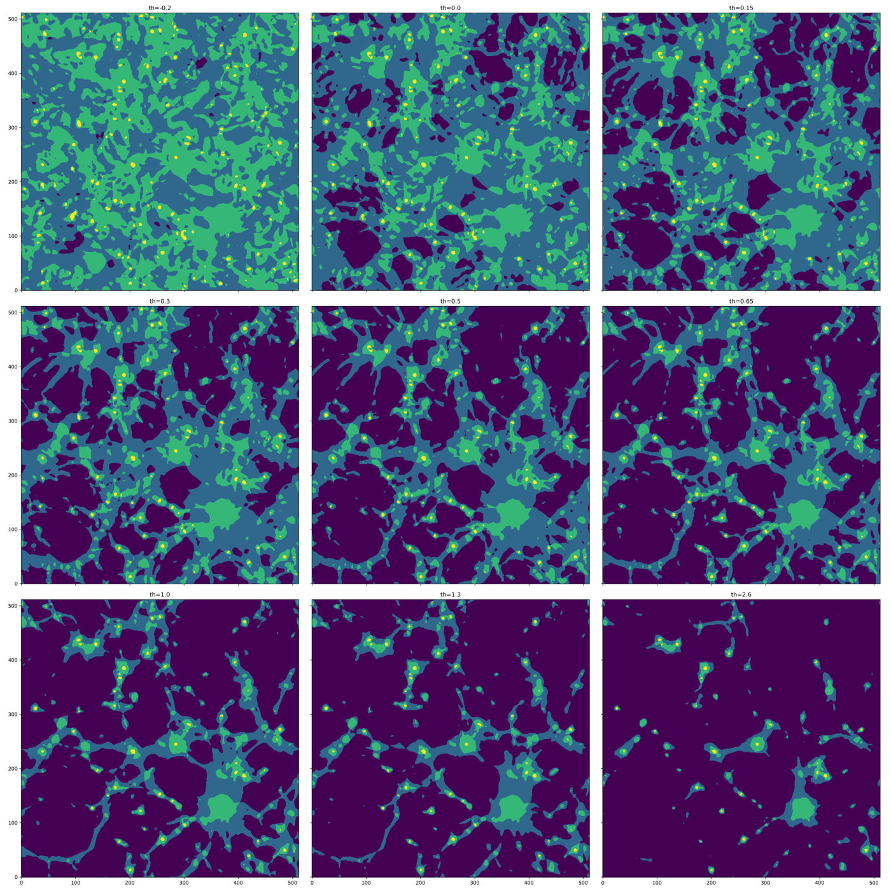
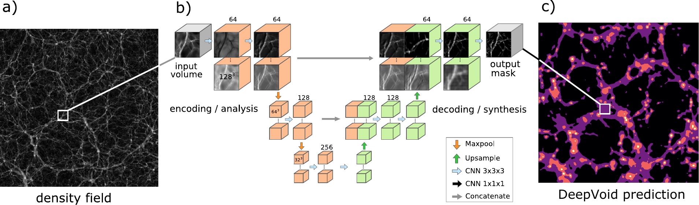
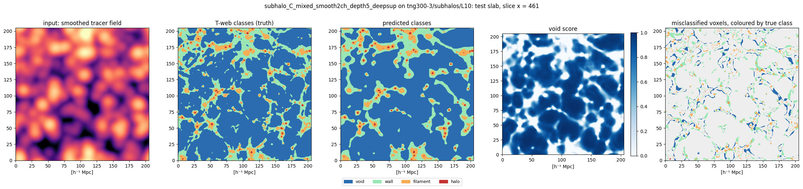
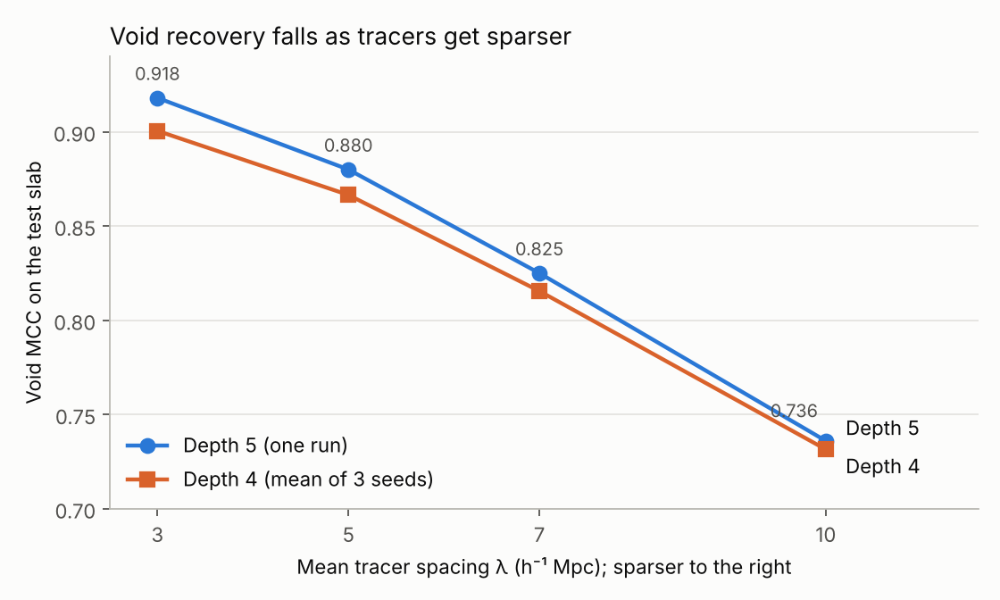

# DeepVoid: the whole problem, step by step

This document explains what DeepVoid does and why, from the physics to the
evaluation. It is written for someone comfortable with calculus, linear
algebra and basic machine learning, but new to cosmology and to this
particular segmentation problem. Equations are written in LaTeX (GitHub
renders them).

## The short version

Galaxies are not scattered evenly through space. They trace a web of dense
knots, threads and sheets, with huge nearly empty regions called voids in
between. Voids are useful for studying dark energy and gravity, but a galaxy
survey only gives us a sparse set of points, and finding the voids from those
points is hard.

DeepVoid is a neural network that takes a sparse set of points and labels
every location in the volume as void, wall, filament or halo. It learns from
a computer simulation of the universe, where the right answer is known.

*What DeepVoid does, on a part of the simulation the model never trained on.
Top: the dark matter in one slice of the simulation and the true classes
computed from it (blue is void). A survey cannot see either of these. Bottom
left: what a survey does see, a sparse set of galaxy-like objects (subhalos,
mean spacing 10 h⁻¹ Mpc; the panel shows those within a slab 10 h⁻¹ Mpc
thick). Bottom right: the classes DeepVoid predicts from those points alone.
The large voids are recovered; thin walls that cross them are often missed.*

The rest of this document explains each step.

Contents

1. [The cosmic web and why voids matter](#1-the-cosmic-web-and-why-voids-matter)
2. [Simulations, tracers and tracer spacing](#2-simulations-tracers-and-tracer-spacing)
3. [From points to a density field](#3-from-points-to-a-density-field)
4. [The labels: the tidal tensor (T-web)](#4-the-labels-the-tidal-tensor-t-web)
5. [The segmentation problem](#5-the-segmentation-problem)
6. [The network: a 3D U-Net](#6-the-network-a-3d-u-net)
7. [Data splits](#7-data-splits)
8. [Inputs: normalization and the smoothed channel](#8-inputs-normalization-and-the-smoothed-channel)
9. [Training](#9-training)
10. [Predicting a whole box](#10-predicting-a-whole-box)
11. [Evaluation](#11-evaluation)
12. [Results so far](#12-results-so-far)
13. [From voxels to a void catalog](#13-from-voxels-to-a-void-catalog)
14. [Glossary](#14-glossary)

---

## 1. The cosmic web and why voids matter

On scales of tens of megaparsecs (1 Mpc ≈ 3.26 million light years), matter
in the universe is not spread evenly. Galaxies sit in a network called the
**cosmic web**:

- **halos**: dense, roughly spherical clumps where galaxies and clusters live;
- **filaments**: long threads connecting halos;
- **walls** (or sheets): thin, flat structures between filaments;
- **voids**: large underdense regions, typically 10–50 h⁻¹ Mpc across, that
  fill most of the volume.

*The real thing: a slice of the galaxy map from the Sloan Digital Sky Survey.
We are at the center; each dot is a galaxy, and distance from the center is
redshift z, the stretching of a galaxy's light by cosmic expansion, which
grows with distance (z = 0.14 is about 2 billion light years). The galaxies trace
filaments and walls around large empty voids. The blank wedges are parts of
the sky the survey did not cover. Image credit: M. Blanton and the Sloan
Digital Sky Survey (SDSS; York et al. 2000), under a Creative Commons
Attribution (CC BY) license.*

*The same kind of structure in a simulation, where the matter between the
galaxies can be seen too. Bright knots are halos, the threads between them
are filaments, and the dark regions are voids. Image credit: TNG
Collaboration (the IllustrisTNG simulations; TNG stands for "The Next
Generation"; https://www.tng-project.org/media/).*

### Why voids are interesting

**They fill most of the volume.** Depending on the definition, voids take up
roughly 60–80% of the volume of the universe (Pan et al. 2012; Cautun et al.
2014; Cai & Neyrinck 2025).

**They keep the imprint of the early universe.** Voids grow from troughs in
the primordial field of density fluctuations (Sheth & van de Weygaert 2004).
In groups and clusters, gravitational collapse folds the matter flow back on
itself (shell-crossing) and the memory of the initial conditions is
scrambled. Void interiors have not gone through this (Falck, Neyrinck &
Szalay 2012), so the initial density profile, and even the pattern of
primordial fluctuations, is partly preserved inside them (Aragon-Calvo &
Szalay 2013; Cai & Neyrinck 2025).

**Voids only get emptier.** Write the density contrast as

$$
\delta(\mathbf{x}) = \frac{\rho(\mathbf{x}) - \bar\rho}{\bar\rho}.
$$

Since ρ ≥ 0, δ ≥ −1, and δ = −1 is perfect emptiness. In linear theory a
perturbation grows in place as δ ∝ D(t), where D(t) is the linear growth
factor, so an initial underdensity (δ < 0) simply becomes more negative.
The Zel'dovich approximation (Zel'dovich 1970) extends this past the linear
regime. It maps the initial (Lagrangian) position **q** to the later
(Eulerian) position

$$
\mathbf{x}(\mathbf{q}, t) = \mathbf{q} + D(t)\,\nabla_q \Phi_0(\mathbf{q}),
$$

and conservation of mass gives

$$
\frac{\rho}{\bar\rho} = \frac{1}{\det J}
= \frac{1}{(1 - D\lambda_1)(1 - D\lambda_2)(1 - D\lambda_3)},
$$

where λ₁ ≥ λ₂ ≥ λ₃ are the eigenvalues of the deformation tensor
$d_{ij} = \partial_i \partial_j \Phi_0$ (these λ's are unrelated to the
tracer spacing λ of Section 2). A caustic (shell-crossing) forms when
det J = 0, that is, when D = 1/λᵢ for some eigenvalue λᵢ > 0. In a void all
three eigenvalues are negative, so with $|\lambda_i| = -\lambda_i$,

$$
\frac{\rho}{\bar\rho} = \prod_{i=1}^{3} \frac{1}{1 + D\,|\lambda_i|}.
$$

Every factor is below 1 and decreases as D grows. The density falls
monotonically, tends to δ = −1 only asymptotically, and no caustic forms in
the interior. Overdense regions are the opposite: some λᵢ > 0, the
denominator reaches zero at a finite time, and the region collapses. The
spherical model gives the same picture with numbers: matter in a void's
interior streams outward, the interior flattens toward a uniform low
density, and the outflowing matter piles up into a ridge at the edge (Palmer
& Voglis 1983; Sheth & van de Weygaert 2004). Interior shells eventually
overtake outer ones. In a matter-dominated universe this shell-crossing
happens when the void has expanded by a factor of about 1.7 in radius and
its mean density has fallen to about 20% of the cosmic mean (Sheth & van de
Weygaert 2004; van de Weygaert & Platen 2011). The Zel'dovich approximation
fails once flows cross, but it describes the basic structure of the cosmic
web well (Bond, Kofman & Pogosyan 1996).

**Their dynamics are simple.** Voids are regions of single-stream flow,
unlike the multistream flow in dense regions (Aragon-Calvo & Szalay 2013;
Falck & Neyrinck 2015). The mean outflow around a void follows linear theory
closely (Hamaus et al. 2014). As a void expands it becomes more spherical
(Icke 1984), although individual voids stay irregular because of the tides
from surrounding structure (van de Weygaert & Platen 2011). Averaged over
many voids, the shape is spherical, which is what the tests below rely on.

**They are small universes of their own.** A void interior behaves like a
patch of a lower-density universe that expands faster than its surroundings
(Goldberg & Vogeley 2004). Dark energy has the same density everywhere, so
where there is little matter it dominates earlier and more strongly: voids
are the most dark-energy-dominated places in the universe (Verza et al.
2019; Cai & Neyrinck 2025). The equation for a spherical shell of radius r
shows what a void responds to,

$$
\frac{\ddot r}{r} = -\frac{4\pi G}{3}\left[\rho_m + (1 + 3w)\,\rho_\Lambda\right],
$$

where ρ_m is the mean matter density inside r, ρ_Λ the dark energy density
and w its equation of state (Cai & Neyrinck 2025). Both the strength of
gravity and the properties of dark energy enter.

Overdense structures broke away from the expansion and collapsed long before
dark energy mattered, and a bound cluster does not expand at all. What
expands is the space between them, and that space is the voids. So to
leading order the accelerated expansion of voids is the primary signature of
dark energy: dense structures accelerate away from each other because the
voids between them are growing (Sheth & van de Weygaert 2004; Bromley &
Geller 2025).

### What people measure with voids

All of these tests need a catalog of voids.

- **Void size function** (number of voids against size). It depends on the
  growth of structure and on the dark energy equation of state (Sheth & van
  de Weygaert 2004; Pisani et al. 2015; Verza et al. 2019; Contarini et al.
  2022), usually written $w(z) = w_0 + w_a\, z/(1+z)$ (Chevallier & Polarski
  2001; Linder 2003). It also responds to neutrino mass (Massara et al.
  2015; Kreisch et al. 2019) and to modifications of gravity (Cai, Padilla &
  Li 2015).
- **Alcock–Paczynski (AP) test** (Alcock & Paczynski 1979; Ryden 1995).
  Stacked voids are spherically symmetric in real space. A survey measures
  redshifts, and turning them into distances needs a cosmological model. If
  the assumed model is wrong, the stack looks stretched or squashed along
  the line of sight, and the size of the stretch gives the product of the
  Hubble rate and the angular diameter distance. Lavaux & Wandelt (2012)
  forecast that for a Euclid-like survey the stacked-void AP test could give
  a dark energy figure of merit several times to roughly twenty times that
  of baryon acoustic oscillations (BAO), depending on the smallest void the
  survey can resolve. That is a forecast from dark-matter-only simulations.
  On real data, Nadathur et al. (2019) measured D_A H / c (D_A is the angular
  diameter distance, H the Hubble rate, c the speed of light) at redshift
  z = 0.57 from voids in the Baryon Oscillation Spectroscopic Survey (BOSS;
  Eisenstein et al. 2011; Dawson et al. 2013) to 1%, about 3.5 times tighter than BAO in the same sample,
  using the void–galaxy correlation function (see also Hamaus et al. 2020).
- **Integrated Sachs–Wolfe (ISW) effect** (Sachs & Wolfe 1967). Dark energy
  makes the gravitational potential of a void decay while a photon of the cosmic microwave background (CMB, the light
  left over from the early universe) is
  crossing it, so the photon does not regain the energy it lost on the way
  in. The result is a cold spot on the CMB. Granett, Neyrinck & Szapudi
  (2008) detected this by stacking the CMB on large voids and superclusters,
  with an amplitude several times the prediction of ΛCDM, the standard
  cosmological model (a cosmological constant Λ as the dark energy, plus
  cold dark matter). Later work is mixed:
  some analyses confirm an excess (Kovács 2018), others agree with
  ΛCDM (Nadathur & Crittenden 2016). All agree on the sign.
- **Gravitational lensing.** Voids deflect light slightly outward. The
  lensing shear of background galaxies (Melchior et al. 2014; Clampitt &
  Jain 2015) and the lensing of the CMB (Cai et al. 2017) measure the total
  matter profile of voids, which tests gravity and neutrino mass (Baker et
  al. 2018).
- **Galaxy formation.** The low-density, undisturbed environment of a void
  is a clean setting for studying how environment shapes galaxies (Kreckel
  et al. 2011; van de Weygaert & Platen 2011).

### The catch: what is a void?

There is no agreed definition. Colberg et al. (2008) ran thirteen void
finders on the same simulated volume: all of them found the large central
void, but the number of voids ranged from 3 to 167 and the fraction of the
volume called void from 13% to 100%. No single definition is the right one
for everything: each test above is best served by a definition suited to
what it measures.

The most widely used finders are watershed methods built on a Voronoi
tessellation of the galaxies: ZOBOV (ZOnes Bordering On Voidness; Neyrinck
2008) and VIDE (the Void IDentification and Examination toolkit; Sutter et
al. 2015). They find density depressions without free parameters or an
assumed void shape (Neyrinck 2008), and their density estimate adapts to the
galaxies, with fine resolution wherever galaxies are dense. The same
adaptivity means coarse resolution where galaxies are few. The Voronoi cells
there are large, and near void edges and survey boundaries, which is where
this happens most often, they can be long, thin polyhedra, so the edge of a
void is located less precisely (Kumagai 2025). Turning the watershed basins
into a catalog takes a significance or density cut (Neyrinck 2008), and the
void centers do not always sit at maxima of the gravitational potential
(Nadathur, Hotchkiss & Crittenden 2017). Sparse tracers are a difficulty for
any finder: voids not much larger than the tracer spacing are dominated by
shot noise and are usually discarded (Contarini, Verza & Pisani 2026).
Veyrat, Douglass & BenZvi (2023) compared two finders against a dynamical
definition (regions with no shell-crossing) and found clear differences in
how well they recover it.

DeepVoid takes a different route (Kumagai et al. 2025). It defines voids by
the physics that creates them and trains a network to recognize that
signature in the kind of data a survey provides, building on the use of
deep networks to classify the cosmic web in Aragon-Calvo (2019). The
definition is the tidal tensor (Hahn et al. 2007; Forero-Romero et al. 2009;
Section 4 below), which is the same eigenvalue criterion as above: a void
voxel has none of the three tidal tensor eigenvalues above the threshold, so
nothing is collapsing along any axis. Because the definition is only a
training target, it can be changed and the model retrained.

### Real surveys

Redshift surveys do not give 3D maps directly. Distances come from redshifts
only after assuming a cosmology, and the observed redshift also contains a
Doppler shift from peculiar velocities (Kaiser 1987). The outflow from a
void stretches it along the line of sight, and the random velocities of
galaxies in groups on the void boundary smear walls and filaments into
"fingers of god" (Jackson 1972). Void finding on such data is affected too,
because the void centers themselves move (Nadathur et al. 2019). Current and
upcoming surveys will map voids to much greater depth:

- the Dark Energy Spectroscopic Instrument (DESI; DESI Collaboration 2016);
- the Prime Focus Spectrograph on the Subaru telescope (PFS; Tamura et al.
  2018);
- the 4-metre Multi-Object Spectroscopic Telescope (4MOST; de Jong et al.
  2016);
- the Vera C. Rubin Observatory Legacy Survey of Space and Time (LSST; LSST
  Science Collaboration 2009; Ivezić et al. 2019);
- SPHEREx, the Spectro-Photometer for the History of the Universe, Epoch of
  Reionization and Ices Explorer (Doré et al. 2018);
- Euclid (Laureijs et al. 2011; Euclid Collaboration: Mellier et al. 2025);
- the Nancy Grace Roman Space Telescope (Spergel et al. 2015; Wang et al.
  2022).
 This work trains on real-space simulation
data, so redshift space and survey effects are outside what the models here
have been tested on.

**Units.** Distances are in h⁻¹ Mpc. Here h is the Hubble constant in units
of 100 km s⁻¹ Mpc⁻¹. Its value depends on the cosmological model you adopt,
so writing distances in h⁻¹ Mpc keeps results independent of that choice.
IllustrisTNG uses h = 0.6774, from a cosmology consistent with the Planck
2015 results (Planck Collaboration 2016): Ω_m = 0.3089, Ω_Λ = 0.6911,
Ω_b = 0.0486, σ₈ = 0.8159, n_s = 0.9667. With that h, the TNG300 box of
205 h⁻¹ Mpc is about 303 Mpc on a side.

## 2. Simulations, tracers and tracer spacing

We cannot see dark matter, which is about 85% of the matter, so we use
**cosmological simulations**. An N-body simulation follows billions of
particles under gravity in a periodic cube (a box whose opposite faces are
identified, so there are no edges) from nearly uniform initial conditions to
today.

DeepVoid uses **IllustrisTNG** (Marinacci et al. 2018; Naiman et al. 2018;
Nelson et al. 2018; Pillepich et al. 2018; Springel et al. 2018; data
release: Nelson et al. 2019), specifically its largest box, TNG300: a periodic box of side
L = 205 h⁻¹ Mpc.

- **Dark matter (DM)** particles sample the matter field densely. Their mean
  spacing is about 0.33 h⁻¹ Mpc.
- **Subhalos** are gravitationally bound clumps found in the simulation.
  Each one is roughly where a galaxy would be. In a real survey we only see
  galaxies, so subhalos stand in for them.

A survey sees far fewer galaxies than a simulation has particles. We
describe how sparse a sample is by its **mean tracer spacing**

$$
\lambda = n^{-1/3},
$$

where n is the number of tracers per unit volume. To build a sample with a
given λ, we keep the N most massive subhalos, with

$$
N = \left(\frac{L}{\lambda}\right)^3 .
$$

| λ (h⁻¹ Mpc) | N subhalos in TNG300 |
|---|---|
| 3 | 319,079 |
| 5 | 68,921 |
| 7 | 25,117 |
| 10 | 8,615 |

For comparison, DESI's luminous red galaxies (Zhou et al. 2023) and
emission-line galaxies (Raichoor et al. 2023) have λ ≈ 11–13 h⁻¹ Mpc. λ = 10 is the regime that matters for real surveys, and
the hardest one.

## 3. From points to a density field

The network works on a regular 3D grid, so the points are turned into a
density field. The grid has N_g = 512 cells per side, so the cell size is

$$
\Delta = \frac{L}{N_g} = 0.40\ h^{-1}\,\mathrm{Mpc}.
$$

**Cloud-in-cell (CIC) assignment.** Each point of mass m at position x
spreads its mass over the 8 nearest grid points, with weight

$$
W(\mathbf{x} - \mathbf{x}_g) = \prod_{i=1}^{3} \max\!\left(0,\ 1 - \frac{|x_i - x_{g,i}|}{\Delta}\right),
$$

so a point sitting exactly on a grid point gives it all its mass, and
total mass is conserved. The density at grid point g is

$$
\rho_g = \frac{1}{\Delta^3}\sum_{p} m_p\, W(\mathbf{x}_p - \mathbf{x}_g),
$$

with periodic wrapping at the box faces.

**Overdensity.** We usually work with the density relative to the mean
$\bar\rho$:

$$
\delta(\mathbf{x}) = \frac{\rho(\mathbf{x})}{\bar\rho} - 1 .
$$

δ = 0 is average density, δ = −1 is empty space, and halos reach δ of
hundreds or more.

At λ = 10, 8,615 points on 512³ ≈ 1.3 × 10⁸ cells means 99.95% of cells are
empty. This is the central difficulty: most of the input is zeros.

## 4. The labels: the tidal tensor (T-web)

The labels come from the **tidal tensor** of the full dark-matter field,
following Hahn et al. (2007) and Forero-Romero et al. (2009). The idea is to
ask, at each point, in how many directions gravity is squeezing matter
together.

**Gravitational potential.** In comoving coordinates (coordinates that
expand with the universe), the peculiar gravitational potential φ obeys
Poisson's equation

$$
\nabla^2 \phi = 4\pi G \bar\rho\, a^2\, \delta ,
$$

where a is the cosmic scale factor. We drop the constant and use the
normalized form

$$
\nabla^2 \phi = \delta .
$$

**Smoothing.** The field is first smoothed with a Gaussian of width σ, so the
classification reflects structure on a chosen scale rather than grid noise.
The grid itself acts as a smoothing of about one cell, σ_G = Δ, so we fix
the **effective** smoothing

$$
\sigma_\mathrm{eff}^2 = \sigma^2 + \sigma_G^2 = (1\ h^{-1}\,\mathrm{Mpc})^2 .
$$

For TNG300 at 512³ this gives σ = 2.4 cells.

**Tidal tensor.** The tidal tensor is the Hessian of the potential:

$$
T_{ij}(\mathbf{x}) = \frac{\partial^2 \phi}{\partial x_i\, \partial x_j} .
$$

On a periodic grid this is computed with Fourier transforms. With
$\hat\delta(\mathbf{k})$ the transform of δ and the Gaussian filter
$\hat W(k) = e^{-k^2\sigma^2/2}$,

$$
\hat\phi(\mathbf{k}) = -\frac{\hat W(k)\,\hat\delta(\mathbf{k})}{k^2},
\qquad
\hat T_{ij}(\mathbf{k}) = -k_i k_j\, \hat\phi(\mathbf{k}) = \frac{k_i k_j}{k^2}\,\hat W(k)\,\hat\delta(\mathbf{k}),
$$

and the k = 0 mode is set to zero. Because $\nabla^2\phi = \delta$, the trace
of T is the smoothed overdensity:

$$
\mathrm{tr}\, T = \lambda_1 + \lambda_2 + \lambda_3 = \delta_\sigma .
$$

*From matter to labels, for one slice through the TNG300 box. Left: the dark
matter density contrast, log10(δ + 1). Middle: the gravitational potential Φ
it produces. The potential is shifted and rescaled before the logarithm is
taken (log10 of Φ/10⁵ + 5.75, in the simulation's units), so its color scale
is for display only; bright regions are highs of the potential, where voids
form. Right: the T-web labels ("tidal mask") computed from the potential's
second derivatives. Figure from Kumagai et al. (2025).*

**Eigenvalues and classes.** T is a real symmetric 3 × 3 matrix at every
point, with eigenvalues λ₁ ≥ λ₂ ≥ λ₃ (these λ's are unrelated to the tracer
spacing λ; the notation clash is standard, unfortunately). A positive
eigenvalue means matter is being compressed along that eigenvector; a
negative one means it is being stretched. Counting compressed directions
gives the structure type:

| Eigenvalues above λ_th | Class | Picture |
|---|---|---|
| 0 | void | expanding in all three directions |
| 1 | wall | collapsing along one direction: a sheet |
| 2 | filament | collapsing along two directions: a thread |
| 3 | halo | collapsing along all three: a knot |

The threshold λ_th = 0.65 is a choice. With λ_th = 0 almost everything is
wall and voids are tiny; a modest positive threshold gives a web that looks
like the observed one. Every DeepVoid label uses λ_th = 0.65 and
σ_eff = 1 h⁻¹ Mpc.

*The same slice labeled with nine different thresholds λ_th, from −0.2 (top
left) to 2.6 (bottom right). Dark purple is void, blue is wall, green is
filament, yellow is halo. Axes are in grid cells. At 0 the voids are small
isolated pockets; at 0.65 (middle right) they connect into the large empty
regions seen by eye. This plot is from an earlier exploration and uses a
different color scheme from the other figures.*

In TNG300 this gives roughly 65% void, 26% wall, 9% filament and 0.5% halo
by volume. The classes are strongly imbalanced.

**Important:** the labels always come from the full dark-matter field, even
when the input is a sparse set of subhalos. The task is to infer the true
structure from incomplete data.

## 5. The segmentation problem

Formally: given an input field $x \in \mathbb{R}^{512^3 \times C}$ (C input
channels), predict a label $y_v \in \{0, 1, 2, 3\}$ (void, wall, filament,
halo) for every voxel v. In computer vision this is **semantic
segmentation**: every pixel (here, voxel) gets a class, but separate
objects of the same class are not told apart. Turning void voxels into
separate voids is a later step (Section 13).

Why it is hard:

- **Sparse input.** At λ = 10 a typical void voxel is 5–10 h⁻¹ Mpc from the
  nearest subhalo. Walls are thin (about 1–2 h⁻¹ Mpc) and often contain no
  subhalo at all. The input simply does not contain enough information to
  locate every wall, so some error is unavoidable.
- **Non-local labels.** φ depends on δ everywhere through Poisson's equation,
  so the label at a point depends on matter well away from it. The network
  needs to see a large neighborhood.
- **Imbalance.** Halo voxels are 0.5% of the volume.

## 6. The network: a 3D U-Net

*The U-Net. A small cube of the density field (a) goes into the network (b).
The left half (orange) repeatedly halves the resolution to see larger
structures; the right half (green) builds the resolution back up; the grey
arrows carry fine detail straight across. The output (c) is a label for every
voxel. Figure by M. A. Aragon-Calvo for Kumagai et al. (2025), adapted from
Aragon-Calvo (2019). It shows 3 levels and 128³ inputs; the current default
is 4 or 5 levels.*

A **convolutional neural network (CNN)** applies the same small filter at
every position. One 3D convolution layer with $C_\mathrm{in}$ input and
$C_\mathrm{out}$ output channels computes

$$
z_{c'}(\mathbf{v}) = b_{c'} + \sum_{c=1}^{C_\mathrm{in}} \sum_{\mathbf{u} \in \{-1,0,1\}^3} w_{c',c}(\mathbf{u})\; x_c(\mathbf{v} + \mathbf{u}),
$$

for a 3 × 3 × 3 filter. The weights w and biases b are learned. Because the
same weights apply everywhere, a CNN responds the same way to a structure
wherever it appears (translation equivariance). It is **not** automatically
rotation equivariant: a rotated input generally gives a different response.

Each convolution is followed by **batch normalization** and a **ReLU** (rectified linear
unit):

$$
\hat z = \frac{z - \mu_B}{\sqrt{\sigma_B^2 + \epsilon}}, \qquad
\tilde z = \gamma \hat z + \beta, \qquad
\mathrm{ReLU}(\tilde z) = \max(0, \tilde z),
$$

where μ_B and σ_B² are the mean and variance over the current batch and γ,
β are learned. At prediction time, running averages of μ and σ² collected
during training are used instead (momentum 0.99).

**U-Net structure** (Ronneberger et al. 2015, 3D version by Çiçek et al.
2016):

- The **encoder** applies two convolutions, then halves the resolution with
  2 × 2 × 2 max pooling (keep the largest of 8 values). It repeats this,
  doubling the number of filters at each level: 16, 32, 64, 128 (depth 4)
  or up to 256 (depth 5).
- The **decoder** doubles the resolution again with transposed convolutions
  and, at each level, concatenates the encoder features from the same
  resolution (**skip connections**). These carry back the fine detail that
  pooling discarded.
- A final 1 × 1 × 1 convolution gives four numbers per voxel, the logits
  z_c, and a **softmax** turns them into class scores:

$$
s_c = \frac{e^{z_c}}{\sum_{c'} e^{z_{c'}}}, \qquad s_c \ge 0, \quad \sum_c s_c = 1 .
$$

We call these **class scores**, not probabilities. Nothing in training
guarantees that a score of 0.7 means "void 70% of the time"; whether it does
is something we measure (calibration, Section 11). The predicted class is
the one with the highest score, $\hat y = \arg\max_c s_c$.

**Receptive field.** The output at one voxel depends only on inputs within
some distance, its receptive field. Each 3³ convolution adds one cell on each
side, and each pooling doubles the size of everything after it. Each extra
level of depth therefore roughly doubles how far the network can see. In
practice the network relies mostly on a smaller region, the *effective*
receptive field; we measured about 12–15 h⁻¹ Mpc. That is comparable to
void sizes, which is why more depth helped.

## 7. Data splits

We have one simulation box, so all training and evaluation data come from
it. The standard machine learning rule is that a model must be scored on
data it was not trained on and that played no part in choosing the model.
Otherwise the score measures how well it fits the training data, not how
well it generalizes.

The box is cut along x into three **slabs**, before anything else happens:

| Part | x cells | Thickness | Used for |
|---|---|---|---|
| Training | [0, 324) | 129.7 h⁻¹ Mpc | fitting the weights; normalization; class weights |
| Buffer | [324, 340) | 6.4 h⁻¹ Mpc | nothing |
| Validation | [340, 410) | 28.0 h⁻¹ Mpc | choosing the best epoch; early stopping |
| Buffer | [410, 426) | 6.4 h⁻¹ Mpc | nothing |
| Test | [426, 496) | 28.0 h⁻¹ Mpc | final scores only |
| Buffer | [496, 512) | 6.4 h⁻¹ Mpc | nothing (it borders the training slab through the periodic wrap) |

Training crops are drawn only from inside the training slab, and
validation crops only from inside the validation slab. No test voxel is ever
used for training or for any decision about the model.

Limitations: the slabs come from one box, and a large void can span two
slabs, so the test set is unseen but not statistically independent of the
training set. A second simulation is the real independence test.

**How the first DeepVoid paper split the data.** The paper cut the box into
128³ subcubes, stored each with three rotated copies (90°, 180°, 270° about
one axis), and split all copies 80/20 at random into training and
validation. Rotated copies of the same region therefore usually ended up on
both sides. The paper treated a rotated subcube as a new example, because a
convolutional network is not rotation-invariant, and reported its scores on
that validation set, saying so.

I tested whether the rotated copies in training help the model on the
validation regions. I trained a model on subhalos at λ = 10 h⁻¹ Mpc with
the paper's split (64 non-overlapping subcubes, four rotations each, 80/20
over copies), after first setting aside 16 subcubes that the model never
saw in any orientation. Every validation subcube had a rotated copy of its
region in training. If those copies helped, validation would score higher
than the 16 unseen subcubes. It does not:

| Mean over regions | Validation (29 regions) | Unseen test (16 regions) | Difference |
|---|---|---|---|
| Four-class MCC | 0.543 ± 0.005 | 0.548 ± 0.006 | −0.005 ± 0.008 |
| Void MCC | 0.597 ± 0.005 | 0.603 ± 0.007 | −0.007 ± 0.009 |

Errors are standard errors over regions; the error on the difference adds
them in quadrature. The difference is consistent with zero, and an advantage
larger than about 0.01 in MCC is excluded at 2σ. For this model, a rotated
copy of a training region is as good as a new region. The test covers one
model (depth 3, 32 filters, trained directly at λ = 10 with the new
optimizer settings); I did not repeat it for the dense dark-matter model or
the curriculum models.

## 8. Inputs: normalization and the smoothed channel

**Normalization.** Densities span many orders of magnitude, and most cells
at large λ are empty. We use

$$
x = \frac{\log_{10}(\rho/\bar\rho + 10^{-3}) - \mu}{s},
$$

where the 10⁻³ keeps empty cells finite, and μ and s are the mean and
standard deviation of $\log_{10}(\rho/\bar\rho + 10^{-3})$ over the training
slab only. The same μ and s are saved with the model and used at prediction
time.

**Smoothed second channel.** A sparse field is mostly zeros, so a 3³ filter
almost never sees a tracer. We add a second channel: the same tracer field
smoothed with a Gaussian of width proportional to the spacing,

$$
\rho_s(\mathbf{x}) = \int \rho(\mathbf{x}')\, \frac{e^{-|\mathbf{x}-\mathbf{x}'|^2/2\sigma^2}}{(2\pi\sigma^2)^{3/2}}\, d^3x', \qquad \sigma = \lambda/2 ,
$$

computed on the grid with periodic boundaries. It is normalized the same way
with its own μ and s. The raw channel is kept, so no information is lost;
the smoothed channel gives every voxel an estimate of the local tracer
density at a scale matched to the sampling. This was the largest single
improvement at λ = 10.

## 9. Training

**Crops and batches.** Each step draws B = 8 crops of 96³ cells
(38 h⁻¹ Mpc) at random positions in the training slab. For each crop, the
tracer spacing is drawn at random from {3, 5, 7, 10}, so one model learns
all spacings. Mixing spacings within a batch matters: batch normalization
statistics computed on a batch of a single spacing would not match the
running averages used at prediction time.

**Augmentation.** A cube has 48 symmetries: 6 permutations of the axes
times 8 combinations of axis reflections (the octahedral group). One is
applied at random to each batch. The physics has no preferred direction, so
this effectively multiplies the training data, and it pushes the network to
treat a structure the same way in any orientation.

**Loss.** For one voxel with true class y and scores s, the cross-entropy is
$-\log s_y$: zero for a perfect, confident prediction, large for a confident
wrong one. Because the classes are imbalanced, each class gets a weight

$$
w_c \propto f_c^{-1/2}, \qquad \sum_c f_c\, w_c = 1,
$$

where f_c is the fraction of training voxels in class c. Rare classes count
more, but less extremely than with full inverse-frequency weights, and the
average voxel weight is 1. The loss over a batch of voxels V is

$$
\mathcal{L} = -\frac{1}{|V|} \sum_{v \in V} w_{y_v} \log s_{v, y_v} .
$$

Two optional terms exist:

- **Void-vs-rest term.** Adds $w_v$ times the binary cross-entropy of the
  void score: $-[\,\mathbb{1}(y = \mathrm{void}) \log s_\mathrm{void} + (1 - \mathbb{1}(y = \mathrm{void})) \log(1 - s_\mathrm{void})\,]$.
  In practice it shifted the void boundary rather than improving it.
- **Deep supervision.** Extra outputs at 1/2, 1/4, … resolution, trained
  against the labels averaged over 2^ℓ × 2^ℓ × 2^ℓ blocks (so a block that
  straddles a boundary has fractional targets), with weights proportional
  to 2^(−ℓ). This gives the deep layers a direct training signal.

**Optimizer.** Weights θ are updated by AdamW (the Adam optimizer with
decoupled weight decay; Loshchilov & Hutter 2019). With gradient g_t at step t:

$$
\begin{aligned}
m_t &= \beta_1 m_{t-1} + (1-\beta_1) g_t, &
v_t &= \beta_2 v_{t-1} + (1-\beta_2) g_t^2, \\
\hat m_t &= \frac{m_t}{1-\beta_1^t}, &
\hat v_t &= \frac{v_t}{1-\beta_2^t}, \\
\theta_t &= \theta_{t-1} - \eta_t \left( \frac{\hat m_t}{\sqrt{\hat v_t} + \epsilon} + w_d\, \theta_{t-1} \right), & &
\end{aligned}
$$

with β₁ = 0.9, β₂ = 0.999, weight decay w_d = 10⁻³, and gradients clipped to
norm at most 1. The learning rate η_t rises linearly for 3 epochs, then
follows a cosine decay to 1% of its peak (10⁻³):

$$
\eta(t) = \eta_\mathrm{min} + \tfrac12 (\eta_\mathrm{max} - \eta_\mathrm{min}) \left[ 1 + \cos\left( \pi\, \frac{t - t_w}{T - t_w} \right) \right] .
$$

**Weight averaging (EMA).** Alongside the trained weights we keep an
exponential moving average,

$$
\bar\theta \leftarrow \beta\, \bar\theta + (1 - \beta)\, \theta, \qquad \beta = \min\!\left(0.999,\ \frac{1 + k}{10 + k}\right) \text{ at step } k ,
$$

which smooths out step-to-step noise. The averaged weights are the ones
validated, saved and used for prediction.

**Model selection and early stopping.** An epoch is 200 steps. After each
epoch the averaged weights are scored on fixed 64³ crops from the validation
slab. The best epoch is saved. Training stops when the score has not
improved by at least 0.002 for 15 epochs.

## 10. Predicting a whole box

The network is fully convolutional, so it can predict on crops of any size
divisible by 2^(depth−1). Near the edge of a crop it sees less context, so
those predictions are worse. To predict the whole 512³ box we:

1. cover it with 128³ crops whose centers are 64 cells apart, wrapping
   around the periodic faces;
2. keep only the central 64³ of each crop, discarding a 32-cell margin;
3. assemble the kept pieces, which tile the box exactly once.

The 32-cell margin (12.8 h⁻¹ Mpc) matches the effective receptive field;
with 16 cells, seams between tiles were visible.

## 11. Evaluation

Every score is computed on the test slab only.

**Confusion matrix.** $C_{kl}$ counts voxels of true class k predicted as l.
Normalizing each row by its sum gives, for example, the fraction of true
wall voxels predicted as void.

**Per-class scores.** For one class treated against the rest, with true
positives TP, false positives FP, false negatives FN and true negatives TN:

$$
\mathrm{precision} = \frac{TP}{TP + FP}, \qquad
\mathrm{recall} = \frac{TP}{TP + FN}, \qquad
F_1 = \frac{2\,TP}{2\,TP + FP + FN}, \qquad
\mathrm{IoU} = \frac{TP}{TP + FP + FN} .
$$

Precision is purity (of the voxels called void, how many are void); recall
is completeness (of the true void voxels, how many were found). IoU is the intersection over union: the overlap between predicted and true
void voxels divided by their union. F1 is the harmonic mean of precision and
recall. The two are related by IoU = F1/(2 − F1).

**Matthews correlation coefficient (MCC).** For a two-class problem,

$$
\mathrm{MCC} = \frac{TP \cdot TN - FP \cdot FN}{\sqrt{(TP+FP)(TP+FN)(TN+FP)(TN+FN)}} .
$$

It is the Pearson correlation between the true and predicted binary labels:
1 for perfect, 0 for no better than chance, −1 for perfectly wrong. Unlike
accuracy, it is not fooled by imbalance. A model that calls everything void
gets 65% accuracy here but MCC 0. **Void MCC** treats void against
everything else and is our headline score.

For K classes we use Gorodkin's (2004) generalization:

$$
\mathrm{MCC} = \frac{c\, s - \sum_k p_k t_k}{\sqrt{\left(s^2 - \sum_k p_k^2\right)\left(s^2 - \sum_k t_k^2\right)}},
$$

with $c = \sum_k C_{kk}$ (correct), $s = \sum_{kl} C_{kl}$ (total),
$t_k = \sum_l C_{kl}$ (true count of k) and $p_k = \sum_l C_{lk}$ (predicted
count of k).

**Balanced accuracy** is the mean of the per-class recalls.

**Precision–recall curves.** Instead of argmax, call a voxel void when
$s_\mathrm{void} \ge t$, and sweep t from 0 to 1. Each t gives a (recall,
precision) pair. The **average precision** summarizes the curve:

$$
\mathrm{AP} = \sum_k (R_k - R_{k+1})\, P_k .
$$

A threshold can be tuned on the validation slab and reported alongside the
argmax scores. It trades purity for completeness, which matters when
building a catalog.

**Calibration.** Group test voxels into 10 bins of void score. In bin b,
compare the mean void score $\bar s_b$ with the fraction of voxels that
really are void, $\bar f_b$. The expected calibration error is

$$
\mathrm{ECE} = \sum_b \frac{n_b}{N}\, \left| \bar f_b - \bar s_b \right| ,
$$

where n_b is the number of voxels in bin b. Small ECE means the void score
can be read as a void frequency, for this data.

## 12. Results so far

Test slab, argmax predictions, one model for all four spacings (depth 5,
smoothed channel):

| λ (h⁻¹ Mpc) | Void MCC | Four-class MCC |
|---|---|---|
| 3 | 0.918 | 0.885 |
| 5 | 0.880 | 0.842 |
| 7 | 0.825 | 0.781 |
| 10 | 0.736 | 0.683 |

*The hardest case, tracer spacing 10 h⁻¹ Mpc, on one slice of the test slab
(depth 5 with deep supervision). From left: the smoothed tracer field the
network is given, the true classes, the predicted classes, the void score,
and the voxels the model got wrong, colored by their true class. Most errors
are true wall (green) predicted as void: thin walls far from any tracer.*

*Void MCC on the test slab against tracer spacing. Depth 4 is the mean of
three seeds, which differ by at most 0.002; depth 5 is a single run.*

At λ = 10, about 27% of true wall voxels are predicted void, and the model's
void scores depend mostly on distance to the nearest tracer. Thin walls far
from any tracer are effectively invisible in the input. Retraining with
different random seeds changes the scores by at most 0.002.

## 13. From voxels to a void catalog

Cosmology needs **individual voids** (positions, sizes, shapes), not just
void voxels. The planned approach:

1. Take the predicted void voxels (or those with $s_\mathrm{void} \ge t$).
2. Group touching voxels into **connected components**: two void voxels
   belong to the same void if they share a face (6-connectivity) or also an
   edge or corner (18- or 26-connectivity).
3. For each void, compute its volume V, effective radius
   $R_\mathrm{eff} = (3V/4\pi)^{1/3}$, and center (for example the volume
   centroid, with care at the periodic faces).
4. Do the same with the true T-web labels and compare: number of voids, the
   distribution of $R_\mathrm{eff}$, center offsets, and overlap of matched
   voids.

The main risk is **merging**: if the thin wall between two voids is missed,
connected components joins them into one large void. The predicted void
surfaces currently have about a third less area than the true ones, which
suggests this happens. Weighting the loss near void boundaries, and
splitting merged regions with a watershed on the void score, are the
planned remedies.

## 14. Glossary

| Term | Meaning |
|---|---|
| h | the Hubble constant divided by 100 km s⁻¹ Mpc⁻¹; its value depends on the assumed cosmology (0.6774 in IllustrisTNG) |
| h⁻¹ Mpc | distance unit that leaves h unspecified; 1 Mpc ≈ 3.26 million light years, so 1 h⁻¹ Mpc ≈ 1.48 Mpc for h = 0.6774 |
| TNG300 cosmology | Planck 2015: Ω_m = 0.3089, Ω_Λ = 0.6911, Ω_b = 0.0486, σ₈ = 0.8159, n_s = 0.9667, h = 0.6774 |
| Comoving coordinates | coordinates that expand with the universe |
| N-body simulation | a simulation following many particles under gravity |
| Dark matter (DM) | matter that interacts only by gravity; most of the mass |
| Subhalo | a bound clump in a simulation; stands in for a galaxy |
| Tracer | any point sample of the matter field (particles, subhalos, galaxies) |
| λ (spacing) | mean distance between tracers, n^(−1/3) |
| δ | overdensity, ρ/ρ̄ − 1 |
| CIC | cloud-in-cell, a way of spreading points onto a grid |
| Tidal tensor | Hessian of the gravitational potential; its eigenvalues give the T-web class |
| λ_th | eigenvalue threshold for the T-web (0.65) |
| σ_eff | effective smoothing scale of the labels (1 h⁻¹ Mpc) |
| Voxel | a 3D grid cell |
| Semantic segmentation | assigning a class to every voxel |
| Class score | the softmax output for a class; not a probability unless shown calibrated |
| Receptive field | the region of input that can affect one output voxel |
| Slab split | splitting the box into separate slabs for training, validation and test |
| EMA | exponential moving average of the weights |
| MCC | Matthews correlation coefficient |
| ECE | expected calibration error |
| Redshift space | positions inferred from redshift, distorted by galaxy velocities (not used yet) |

### References

- Alcock & Paczynski 1979, Nature 281, 358
- Aragon-Calvo & Szalay 2013, MNRAS 428, 3409, [arXiv:1203.0248](https://arxiv.org/abs/1203.0248)
- Aragon-Calvo 2019, MNRAS 484, 5771, [arXiv:1804.00816](https://arxiv.org/abs/1804.00816)
- Baker et al. 2018, Phys. Rev. D 98, 023511, [arXiv:1803.07533](https://arxiv.org/abs/1803.07533)
- Bond, Kofman & Pogosyan 1996, Nature 380, 603, [arXiv:astro-ph/9512141](https://arxiv.org/abs/astro-ph/9512141)
- Bos et al. 2012, MNRAS 426, 440, [arXiv:1205.4238](https://arxiv.org/abs/1205.4238)
- Bromley & Geller 2025, JCAP 01, 011, [arXiv:2407.03882](https://arxiv.org/abs/2407.03882)
- Cai & Neyrinck 2025, Cosmology with Cosmic Voids, [arXiv:2503.22532](https://arxiv.org/abs/2503.22532)
- Cai et al. 2017, MNRAS 466, 3364, [arXiv:1609.00301](https://arxiv.org/abs/1609.00301)
- Cai, Padilla & Li 2015, MNRAS 451, 1036, [arXiv:1410.1510](https://arxiv.org/abs/1410.1510)
- Cautun et al. 2014, MNRAS 441, 2923, [arXiv:1401.7866](https://arxiv.org/abs/1401.7866)
- Chevallier & Polarski 2001, Int. J. Mod. Phys. D 10, 213, [arXiv:gr-qc/0009008](https://arxiv.org/abs/gr-qc/0009008)
- Çiçek et al. 2016, MICCAI, LNCS 9901, 424 (3D U-Net), [arXiv:1606.06650](https://arxiv.org/abs/1606.06650)
- Clampitt & Jain 2015, MNRAS 454, 3357, [arXiv:1404.1834](https://arxiv.org/abs/1404.1834)
- Colberg et al. 2008, MNRAS 387, 933, [arXiv:0803.0918](https://arxiv.org/abs/0803.0918)
- Contarini et al. 2022, A&A 667, A162, [arXiv:2205.11525](https://arxiv.org/abs/2205.11525)
- Contarini, Verza & Pisani 2026, The era of precision cosmology with voids, [arXiv:2601.14362](https://arxiv.org/abs/2601.14362)
- Dawson et al. 2013, AJ 145, 10 (BOSS), [arXiv:1208.0022](https://arxiv.org/abs/1208.0022)
- de Jong et al. 2016, Proc. SPIE 9908, 473 (4MOST)
- DESI Collaboration 2016, The DESI Experiment Part I: Science, Targeting, and Survey Design, [arXiv:1611.00036](https://arxiv.org/abs/1611.00036)
- Doré et al. 2018, Science Impacts of the SPHEREx All-Sky Optical to Near-Infrared Spectral Survey II, [arXiv:1805.05489](https://arxiv.org/abs/1805.05489)
- Eisenstein et al. 2011, AJ 142, 72 (SDSS-III)
- Euclid Collaboration: Mellier et al. 2025, A&A 697, A1 (Euclid. I. Overview of the Euclid mission), [arXiv:2405.13491](https://arxiv.org/abs/2405.13491)
- Falck & Neyrinck 2015, MNRAS 450, 3239, [arXiv:1410.4751](https://arxiv.org/abs/1410.4751)
- Falck, Neyrinck & Szalay 2012, ApJ 754, 126, [arXiv:1201.2353](https://arxiv.org/abs/1201.2353)
- Forero-Romero et al. 2009, MNRAS 396, 1815 (eigenvalue threshold), [arXiv:0809.4135](https://arxiv.org/abs/0809.4135)
- Goldberg & Vogeley 2004, ApJ 605, 1, [arXiv:astro-ph/0307191](https://arxiv.org/abs/astro-ph/0307191)
- Gorodkin 2004, Comput. Biol. Chem. 28, 367 (multiclass MCC)
- Granett, Neyrinck & Szapudi 2008, ApJ 683, L99, [arXiv:0805.3695](https://arxiv.org/abs/0805.3695)
- Hahn, Porciani, Carollo & Dekel 2007, MNRAS 375, 489 (tidal-tensor classification), [arXiv:astro-ph/0610280](https://arxiv.org/abs/astro-ph/0610280)
- Hamaus et al. 2020, JCAP 12, 023, [arXiv:2007.07895](https://arxiv.org/abs/2007.07895)
- Hamaus, Sutter & Wandelt 2014, Phys. Rev. Lett. 112, 251302, [arXiv:1403.5499](https://arxiv.org/abs/1403.5499)
- Icke 1984, MNRAS 206, 1P
- Ivezić et al. 2019, ApJ 873, 111 (LSST), [arXiv:0805.2366](https://arxiv.org/abs/0805.2366)
- Jackson 1972, MNRAS 156, 1P, [arXiv:0810.3908](https://arxiv.org/abs/0810.3908)
- Kaiser 1987, MNRAS 227, 1
- Kovács 2018, MNRAS 475, 1777, [arXiv:1701.08583](https://arxiv.org/abs/1701.08583)
- Kreckel et al. 2011, AJ 141, 4, [arXiv:1008.4616](https://arxiv.org/abs/1008.4616)
- Kreisch et al. 2019, MNRAS 488, 4413, [arXiv:1808.07464](https://arxiv.org/abs/1808.07464)
- Kumagai 2025, PhD dissertation, Drexel University
- Kumagai et al. 2025, DeepVoid: A Deep Learning Void Detector, [arXiv:2504.21134](https://arxiv.org/abs/2504.21134)
- Laureijs et al. 2011, Euclid Definition Study Report, [arXiv:1110.3193](https://arxiv.org/abs/1110.3193)
- Lavaux & Wandelt 2012, ApJ 754, 109, [arXiv:1110.0345](https://arxiv.org/abs/1110.0345)
- Linder 2003, Phys. Rev. Lett. 90, 091301, [arXiv:astro-ph/0208512](https://arxiv.org/abs/astro-ph/0208512)
- Loshchilov & Hutter 2019, ICLR (AdamW), [arXiv:1711.05101](https://arxiv.org/abs/1711.05101)
- LSST Science Collaboration 2009, LSST Science Book, Version 2.0, [arXiv:0912.0201](https://arxiv.org/abs/0912.0201)
- Marinacci et al. 2018, MNRAS 480, 5113 (IllustrisTNG)
- Massara et al. 2015, JCAP 11, 018, [arXiv:1506.03088](https://arxiv.org/abs/1506.03088)
- Melchior et al. 2014, MNRAS 440, 2922, [arXiv:1309.2045](https://arxiv.org/abs/1309.2045)
- Nadathur & Crittenden 2016, ApJ 830, L19, [arXiv:1608.08638](https://arxiv.org/abs/1608.08638)
- Nadathur et al. 2019, Phys. Rev. D 100, 023504, [arXiv:1904.01030](https://arxiv.org/abs/1904.01030)
- Nadathur, Hotchkiss & Crittenden 2017, MNRAS 467, 4067, [arXiv:1610.08382](https://arxiv.org/abs/1610.08382)
- Naiman et al. 2018, MNRAS 477, 1206 (IllustrisTNG)
- Nelson et al. 2018, MNRAS 475, 624 (IllustrisTNG), [arXiv:1707.03395](https://arxiv.org/abs/1707.03395)
- Nelson et al. 2019, ComAC 6, 2 (IllustrisTNG data release), [arXiv:1812.05609](https://arxiv.org/abs/1812.05609)
- Neyrinck 2008, MNRAS 386, 2101, [arXiv:0712.3049](https://arxiv.org/abs/0712.3049)
- Palmer & Voglis 1983, MNRAS 205, 543
- Pan et al. 2012, MNRAS 421, 926, [arXiv:1103.4156](https://arxiv.org/abs/1103.4156)
- Pillepich et al. 2018, MNRAS 475, 648 (IllustrisTNG), [arXiv:1707.03406](https://arxiv.org/abs/1707.03406)
- Pisani et al. 2015, Phys. Rev. D 92, 083531, [arXiv:1503.07690](https://arxiv.org/abs/1503.07690)
- Planck Collaboration 2016, A&A 594, A13 (Planck 2015 results. XIII. Cosmological parameters), [arXiv:1502.01589](https://arxiv.org/abs/1502.01589)
- Raichoor et al. 2023, AJ 165, 126 (DESI emission-line galaxies), [arXiv:2208.08513](https://arxiv.org/abs/2208.08513)
- Ronneberger, Fischer & Brox 2015, MICCAI (U-Net), [arXiv:1505.04597](https://arxiv.org/abs/1505.04597)
- Ryden 1995, ApJ 452, 25, [arXiv:astro-ph/9506028](https://arxiv.org/abs/astro-ph/9506028)
- Sachs & Wolfe 1967, ApJ 147, 73
- Sheth & van de Weygaert 2004, MNRAS 350, 517, [arXiv:astro-ph/0311260](https://arxiv.org/abs/astro-ph/0311260)
- Spergel et al. 2015, WFIRST-AFTA 2015 Report (Roman), [arXiv:1503.03757](https://arxiv.org/abs/1503.03757)
- Springel et al. 2018, MNRAS 475, 676 (IllustrisTNG), [arXiv:1707.03397](https://arxiv.org/abs/1707.03397)
- Sutter et al. 2015, Astron. Comput. 9, 1, [arXiv:1406.1191](https://arxiv.org/abs/1406.1191)
- Tamura et al. 2018, Proc. SPIE 10702, 107021C (PFS)
- Verza et al. 2019, JCAP 12, 040, [arXiv:1906.00409](https://arxiv.org/abs/1906.00409)
- Veyrat, Douglass & BenZvi 2023, ApJ 958, 59, [arXiv:2302.05469](https://arxiv.org/abs/2302.05469)
- Wang et al. 2022, ApJ 928, 1 (Roman High Latitude Spectroscopic Survey), [arXiv:2110.01829](https://arxiv.org/abs/2110.01829)
- van de Weygaert & Platen 2011, Int. J. Mod. Phys. Conf. Ser. 1, 41, [arXiv:0912.2997](https://arxiv.org/abs/0912.2997)
- York et al. 2000, AJ 120, 1579 (SDSS), [arXiv:astro-ph/0006396](https://arxiv.org/abs/astro-ph/0006396)
- Zel'dovich 1970, A&A 5, 84
- Zhou et al. 2023, AJ 165, 58 (DESI luminous red galaxies), [arXiv:2208.08515](https://arxiv.org/abs/2208.08515)
